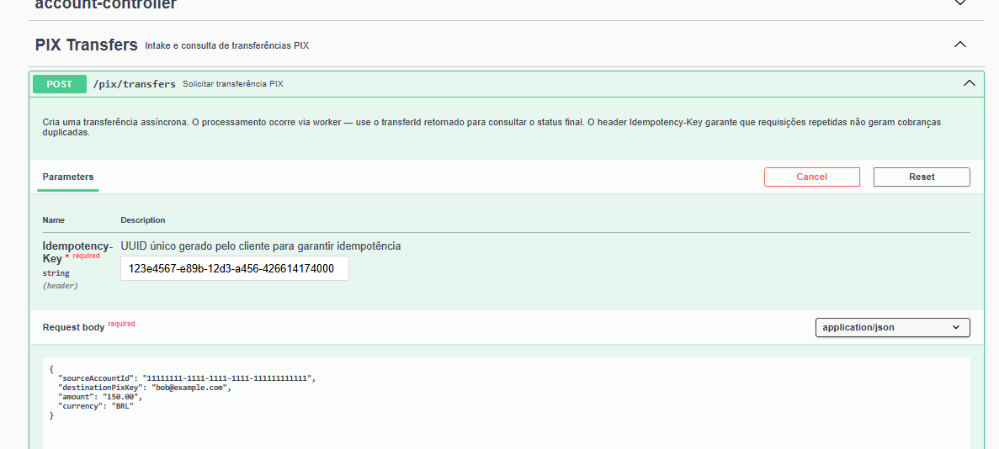
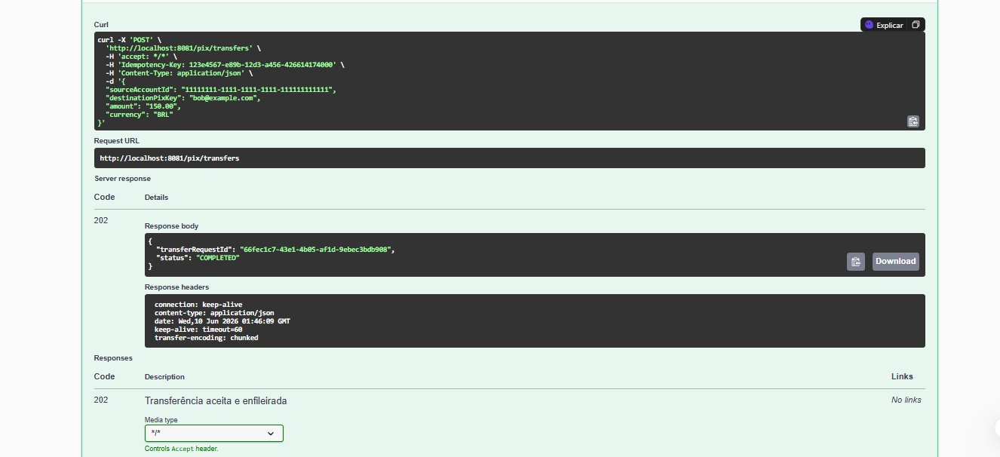

# LedgerBank — Instant Payment PIX API

[](https://github.com/GustavoHRdev/LedgerBank---Instant-Payment---Pix-API/actions/workflows/ci.yml)

Sistema bancário simplificado com transferências PIX assíncronas, modelagem financeira imutável e mecanismos de consistência distribuída.

---

## Por que este projeto existe

A maioria dos projetos de portfólio que implementam transferências faz:

```java
account.setSaldo(account.getSaldo() - valor); // ❌
repository.save(account);
```

Isso quebra em produção. Race conditions, saldo negativo indevido, dinheiro que some entre serviços.

Este projeto foi construído para demonstrar como um sistema financeiro real funciona:
- O saldo não é armazenado na linha da conta; a liquidação registra lançamentos no ledger do Payment Service
- O Outbox Pattern persiste a intenção de publicação junto com a operação de negócio e permite novas tentativas
- Mensagens podem ser entregues novamente; o processamento idempotente protege os efeitos financeiros
- Falhas são cidadãos de primeira classe — estados explícitos e DLQ

O fluxo aceita redelivery e não promete entrega única. No Payment Service, a verificação de `message_id`, a restrição única em `processed_messages` e a liquidação na mesma transação protegem os efeitos financeiros contra processamento repetido.

---

## Arquitetura

```
┌─────────────────────────────────────────────────────────────┐
│                        Client                               │
└──────────────────────────┬──────────────────────────────────┘
                           │ POST /pix/transfers
                           │ Idempotency-Key header
                           ▼
┌─────────────────────────────────────────────────────────────┐
│                   account-service :8081                     │
│                                                             │
│  ┌─────────────┐   ┌──────────────┐   ┌─────────────────┐   │
│  │  Controller │──▶│TransferRequest│──▶│  OutboxPublisher│  │
│  └─────────────┘   │   Service    │   │  (@Scheduled)   │   │
│                    └──────────────┘   └────────┬────────┘   │
│                    (mesma transação)            │           │
│  ┌──────────────────────────────────┐           │           │
│  │  transfer_requests               │           │           │
│  │  idempotency_records             │           │           │
│  │  outbox_events ◀─────────────────┘           │           │
│  └──────────────────────────────────┘           │           │
└─────────────────────────────────────────────────┼───────────┘
                                                  │ pix.events
                                                  │ transfer.requested
                                                  ▼
                                        ┌─────────────────┐
                                        │    RabbitMQ     │
                                        │  pix.events     │
                                        │  (direct)       │
                                        └────────┬────────┘
                                                 │
                           ┌─────────────────────┼──────────────────────┐
                           │                     │                      │
                    transfer.requested    transfer.completed      transfer.failed
                           │                     │                      │
                           ▼                     ▼                      ▼
┌──────────────────────────────┐   ┌─────────────────────────────────────────┐
│     payment-service :8082    │   │            account-service              │
│                              │   │                                         │
│  PixTransferRequestedConsumer│   │  PixTransferCompletedConsumer           │
│         │                    │   │  PixTransferFailedConsumer              │
│         ▼                    │   │         │                               │
│  TransferLiquidationService  │   │         ▼                               │
│         │                    │   │  TransferNotificationService            │
│  SELECT FOR UPDATE (lock)    │   │  (atualiza status + audit_events)       │
│  INSERT DEBIT (ledger)       │   └─────────────────────────────────────────┘
│  INSERT CREDIT (ledger)      │
│  outbox_events ──────────────┼──▶ pix.events / transfer.completed
└──────────────────────────────┘
```

---

## Decisões técnicas

### Ledger da liquidação e saldo da conta

`accounts` não armazena uma coluna de saldo. O Payment Service mantém o histórico financeiro em `payment_db.ledger_entries`, que inclui `running_balance` em cada lançamento. A leitura do saldo usa o último `running_balance`; se não houver lançamentos, o serviço calcula o saldo a partir dos tipos `CREDIT`, `DEBIT`, `REVERSAL_CREDIT` e `REVERSAL_DEBIT`.

O Account Service possui outra tabela `ledger_entries` em `account_db`, com `transfer_request_id`, `currency` e sem `running_balance`. A tabela do Account Service não é onde o Payment Service grava os lançamentos da liquidação.

```sql
-- ❌ O que a maioria faz
UPDATE accounts SET saldo = saldo - 150.00 WHERE id = ?

-- ✅ Exemplo da tabela payment_db.ledger_entries
INSERT INTO ledger_entries
    (id, account_id, transfer_id, entry_type, amount, running_balance, created_at)
VALUES
    ('aaaaaaaa-aaaa-aaaa-aaaa-aaaaaaaaaaaa',
     '11111111-1111-1111-1111-111111111111',
     'bbbbbbbb-bbbb-bbbb-bbbb-bbbbbbbbbbbb',
     'DEBIT', 150.0000, 850.0000, now());
```

Com saldo mutável em `accounts`, duas transferências simultâneas poderiam ler `1000.00`, subtrair `150.00` e gravar ambas `850.00`. O Payment Service bloqueia a conta pagadora com `SELECT ... FOR UPDATE` durante o cálculo e a gravação dos lançamentos.

O histórico do Payment Service registra valores positivos e o tipo do lançamento; o cálculo do saldo soma créditos e subtrai débitos. `running_balance` é um saldo acumulado persistido por lançamento, não uma coluna da tabela `accounts`.

### `BigDecimal` — por que não `double`

```java
// ❌ ponto flutuante binário
double a = 0.1 + 0.2; // = 0.30000000000000004

// ✅ decimal exato
BigDecimal a = new BigDecimal("0.1").add(new BigDecimal("0.2")); // = 0.3
```

Em dinheiro, imprecisão não existe. No banco: `DECIMAL(19,4)`. Na API: `amount` trafega como `String` JSON para evitar que o runtime deserialize como `double` antes de chegar no código.

### Outbox Pattern — por que não publicar direto no RabbitMQ

```
❌ Sem Outbox:
  1. commit no banco           ← processo morre aqui
  2. rabbitTemplate.send()     ← nunca executa
  resultado: banco tem a transferência, fila não tem o evento

✅ Com Outbox:
  1. INSERT outbox_events }
  2. INSERT transfer_request } mesma transação — ou tudo ou nada
  3. @Scheduled lê outbox e publica na fila
  resultado: a intenção de publicação fica persistida e pode ser tentada novamente
```

O envio ao RabbitMQ e a atualização do estado da Outbox não formam uma transação distribuída. Falhas podem deixar o evento pendente para retry ou causar publicação repetida; entrega depende também do publisher, do broker e da configuração operacional.

### Idempotência da solicitação

`idempotency_records` associa a chave, o hash do payload e a transferência criada. O serviço consulta a tabela antes de criar a transferência; a restrição única em `(account_id, idempotency_key)` impede registros duplicados. A implementação atual não usa `INSERT ... ON CONFLICT DO NOTHING`: duas primeiras solicitações concorrentes com a mesma chave podem disputar a restrição única, e o comportamento dessa corrida não está coberto por um teste de integração.

### Estados de transação

```
PENDING ──▶ PROCESSING ──▶ COMPLETED
                       └──▶ FAILED      (dinheiro nunca saiu)
                       └──▶ REVERSED    (débito ocorreu, crédito falhou)
```

`FAILED` e `REVERSED` são estados diferentes por uma razão contábil: `FAILED` significa que nenhuma entrada foi feita no ledger. `REVERSED` significa que há um `DEBIT` e um `REVERSAL_CREDIT` registrados — o efeito econômico é zero, mas a trilha existe.

---

## Stack

| Camada | Tecnologia | Por quê |
|---|---|---|
| Runtime | Java 21 | Versão usada pelos módulos e imagens Docker |
| Framework | Spring Boot 3.5 | Ecossistema maduro, integração nativa com RabbitMQ e JPA |
| Banco | PostgreSQL 16 | ACID real, `SELECT FOR UPDATE`, `DECIMAL(19,4)` |
| Idempotência | PostgreSQL | `idempotency_records` no `account_db` e `processed_messages` nos serviços |
| Fila | RabbitMQ 3.13 | Direct exchanges, filas duráveis, DLQ e management UI |
| Migrations | Flyway | Histórico versionado, sem surpresa entre ambientes |
| Testes | Testcontainers + Awaitility | PostgreSQL e RabbitMQ em containers; recuperação também usa injeção de falha |
| Container | Docker + Docker Compose | Stack completa com um comando |

---

## Como rodar

**Pré-requisitos:** Docker Desktop, JDK 21

```bash
# clona o repositório
git clone https://github.com/GustavoHRdev/LedgerBank---Instant-Payment---Pix-API.git
cd "LedgerBank---Instant-Payment---Pix-API"

# sobe toda a stack
docker compose up --build
```

No Windows, os scripts `.sh` do diretório `docker/` são mantidos com line ending `LF` via `.gitattributes`. Isso evita erro de inicialização do PostgreSQL ao executar `docker/postgres/init-multiple-dbs.sh`.

Aguarda as linhas:
```
account-service | Started AccountServiceApplication
payment-service | Started PaymentServiceApplication
```

Documentação interativa da API:
- Swagger UI: `http://localhost:8081/swagger-ui.html`
- OpenAPI JSON: `http://localhost:8081/api-docs`

### Swagger UI

Solicitação de transferência PIX:



Resposta `202 Accepted`:



---

## Testando o fluxo

### 1. Transferência PIX (happy path)

```bash
curl -X POST http://localhost:8081/pix/transfers \
  -H "Content-Type: application/json" \
  -H "Idempotency-Key: meu-uuid-unico" \
  -d '{
    "sourceAccountId": "11111111-1111-1111-1111-111111111111",
    "destinationPixKey": "bob@example.com",
    "amount": "150.00",
    "currency": "BRL"
  }'
```

Resposta imediata (`202 Accepted`):
```json
{ "transferRequestId": "uuid", "status": "PENDING" }
```

### 2. Polling de status

```bash
curl http://localhost:8081/pix/transfers/{transferRequestId}
```

Após ~3 segundos:
```json
{
  "transferId": "uuid",
  "status": "COMPLETED",
  "amount": "150.0000",
  "completedAt": "2026-05-21T03:20:12.542237Z"
}
```

### 3. Verificar ledger (prova de imutabilidade)

```bash
docker compose exec postgres psql -U pixuser -d payment_db \
  -c "SELECT account_id, entry_type, amount, running_balance FROM ledger_entries ORDER BY created_at;"
```

```
 account_id                            | entry_type | amount    | running_balance
---------------------------------------+------------+-----------+----------------
 11111111-1111-1111-1111-111111111111  | CREDIT     | 1000.0000 | 1000.0000   ← seed
 11111111-1111-1111-1111-111111111111  | DEBIT      |  150.0000 |  850.0000   ← transferência
 22222222-2222-2222-2222-222222222222  | CREDIT     |  150.0000 |  150.0000   ← recebimento
```

### 4. Idempotência (mesmo request, sem duplicação)

```bash
# segundo request com a mesma Idempotency-Key
curl -X POST http://localhost:8081/pix/transfers \
  -H "Idempotency-Key: meu-uuid-unico" \
  ...

# ledger permanece com 3 entradas — não duplicou
docker compose exec postgres psql -U pixuser -d payment_db \
  -c "SELECT COUNT(*) FROM ledger_entries;"
# count = 3
```

### 5. Saldo insuficiente

```bash
curl -X POST http://localhost:8081/pix/transfers \
  -H "Idempotency-Key: outro-uuid" \
  -d '{ ..., "amount": "99999.00" }'

# polling retorna:
# { "status": "FAILED", "failureReason": "INSUFFICIENT_BALANCE" }
```

---

## Rodando os testes de integração

> **Windows + Docker Desktop:** os dois módulos incluem
> `src/test/resources/docker-java.properties` com `api.version=1.44`.
> Configure o endpoint do Docker Desktop antes de rodar os comandos abaixo:
>
> ```properties
> api.version=1.44
> ```
>
> E rode com a variável de ambiente:
>
> ```powershell
> $env:DOCKER_HOST='npipe:////./pipe/dockerDesktopLinuxEngine'
> mvn -f account-service/pom.xml test
> mvn -f payment-service/pom.xml test
> ```
>
> Linux e macOS não precisam dessa configuração.

Execute ambos os comandos a partir da raiz do repositório; cada um roda a
suíte do módulo indicado, como os dois passos do workflow de CI.

```bash
mvn -f account-service/pom.xml test
mvn -f payment-service/pom.xml test
```

Resultados da execução local de `mvn test` em cada módulo, em 25 nov 2026:

| Módulo | Resultado |
|---|---|
| `account-service` | 3 testes, 0 falhas, 0 erros, 0 ignorados |
| `payment-service` | 4 testes, 0 falhas, 0 erros, 0 ignorados |

Os testes de integração do Account Service sobem PostgreSQL, RabbitMQ e o `payment-service` em containers Testcontainers para exercitar o fluxo E2E de transferência.

Os testes de integração do Payment Service utilizam PostgreSQL 16 e RabbitMQ via Testcontainers.

- `ConcurrentMessageIdempotencyTest` valida duas chamadas concorrentes com o mesmo `message_id`; apenas uma persiste débito, crédito, evento de conclusão e registro em `processed_messages`.
- `MessagingRecoveryTest` deixa uma mensagem na fila com o listener parado e depois o inicia; simula a janela após commit e antes do ACK usando `basicGet` sem confirmação, chama o orquestrador e fecha o canal para provocar redelivery; também injeta falha de conexão no `RabbitTemplate` para verificar a recuperação da publicação da Outbox.

No cenário de indisponibilidade do broker, a exceção é injetada no cliente de publicação; o container RabbitMQ não é interrompido. Os resultados cobrem esses cenários específicos, não todos os modos de falha e recuperação possíveis.

---

## Estrutura do projeto

```
├── account-service/        # intake de transferências, idempotência, status
│   ├── src/main/
│   │   ├── controller/     # endpoints REST
│   │   ├── service/        # regras de negócio
│   │   ├── domain/         # entidades e repositórios
│   │   └── infra/          # RabbitMQ, scheduling, segurança
│   └── src/test/
│       └── integration/    # Testcontainers
│
├── payment-service/        # liquidação transacional, ledger, worker
│   ├── src/main/
│   │   ├── worker/         # consumidor RabbitMQ
│   │   ├── service/        # lock pessimista, DEBIT/CREDIT
│   │   └── domain/         # LedgerEntry, TransferRequest
│   └── src/main/resources/
│       └── db/migration/   # Flyway
│
├── docker-compose.yml      # stack completa local
└── docker/
    └── postgres/
        └── init-multiple-dbs.sh
```

---

## Filas RabbitMQ

| Fila | Produzida por | Consumida por |
|---|---|---|
| `payment.transfer-processor` | account-service | payment-service |
| `account.notification-sender.completed` | payment-service | account-service |
| `account.notification-sender.failed` | payment-service | account-service |
| `pix.dead-letter` | RabbitMQ (após retries) | investigação manual |

Painel de administração: `http://localhost:15672` (pixuser/pixpass)

---

## Próximas evoluções (fase 2)

Roadmap detalhado: [`docs/ROADMAP.md`](docs/ROADMAP.md)

| Melhoria | Objetivo | Impacto técnico |
|---|---|---|
| QR Code dinâmico com `fund_reservations` e expiração | Criar cobranças PIX temporárias com reserva de saldo antes da liquidação | Evita overbooking de saldo e aproxima o fluxo de cobrança do mundo real |
| Reconciliação do ledger em `payment_db` | Job que compara o saldo assinado por `entry_type` com o último `running_balance` | Detecta divergências contábeis sem alterar dados automaticamente |
| `expires_at` em `processed_messages` + job de limpeza | Controlar crescimento da tabela de mensagens processadas | Mantém idempotência dentro da janela de retenção sem crescimento infinito |
| Métricas com Micrometer + Grafana | Expor throughput, falhas, latência e saúde dos workers | Dá visibilidade operacional para debugging e demonstração técnica |
| `balance_snapshots` | Otimizar leitura de saldo em contas com histórico longo | Reduz custo de consulta sem abandonar ledger imutável |
